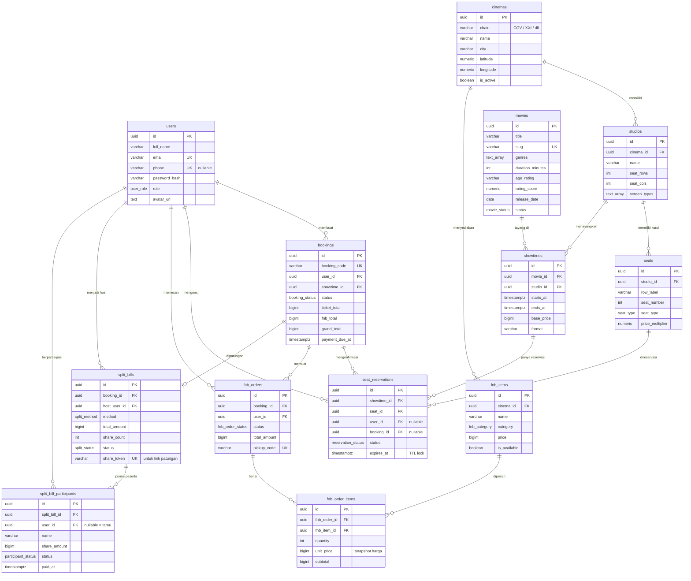

# CineGen — Database Design (PostgreSQL)

> Dikelola via file SQL di `backend/migrations/`, dijalankan dengan `npm run db:migrate`.
> Konvensi: UUID primary key, `TIMESTAMPTZ` (UTC), uang sebagai `BIGINT` Rupiah utuh (IDR tanpa sen).

## 1. ERD (Entity Relationship Diagram)



## 2. Penjelasan Tabel

### 2.1. `users`
Data akun pengguna. Email unik secara *case-insensitive* (indeks `lower(email)`), nomor HP opsional namun unik. Password disimpan sebagai hash bcrypt (TAHAP 3). Kolom `role` membedakan penonton biasa dan admin.

### 2.2. `cinemas` & `studios`
- `cinemas` = lokasi fisik bioskop (kolom `chain` untuk agregasi per jaringan: CGV, XXI, dll).
- `studios` = teater di dalam bioskop. `seat_rows`/`seat_cols` dipakai aplikasi mobile untuk me-render peta kursi; `screen_types` array (mis. `{imax}`) memengaruhi harga (`base_price` di showtime) dan label format.

### 2.3. `movies` & `showtimes`
- `movies`: katalog film dengan `slug` (URL-friendly untuk deep link mobile), `genres` array (diindeks GIN untuk filter genre), `status` untuk memisahkan *now showing* vs *coming soon*.
- `showtimes`: satu tayangan film di satu studio pada rentang waktu tertentu.
  - **Constraint kunci:** `EXCLUDE USING gist` memastikan tidak ada dua tayangan yang **tumpang tindih** di studio yang sama (bukan sekadar tidak identik) — memakai `tstzrange(starts_at, ends_at) WITH &&` + ekstensi `btree_gist`.
  - `ends_at` disimpan eksplisit (bukan dihitung on-the-fly) agar constraint overlap bisa diindeks GiST.

### 2.4. `seats` & `seat_reservations` (inti seat locking)
- `seats`: denah kursi per studio. `seat_type` (regular/premium/couple) × `price_multiplier` menentukan harga akhir: `harga kursi = base_price × price_multiplier`.
- `seat_reservations`: satu baris = satu kursi pada satu showtime, dengan status:
  - `locked` → sedang dikunci user (proses bayar), punya `expires_at` (TTL, default 10 menit)
  - `confirmed` → tiket terbit (booking lunas)
  - `released` → lock kedaluwarsa/dibatalkan, kursi bebas lagi
- **Anti double-booking:** *partial unique index* `UNIQUE (showtime_id, seat_id) WHERE status IN ('locked','confirmed')` — database menjamin satu kursi hanya bisa dikunci/dikonfirmasi sekali per showtime; percobaan ganda otomatis ditolak (error 23505), tidak bergantung pada logika aplikasi.
- **Lifecycle lock:** Redis (TAHAP 3) memegang lock cepat real-time; tabel ini adalah *source of truth*. Lock kedaluwarsa dilazily dibersihkan: `UPDATE seat_reservations SET status='released' WHERE status='locked' AND expires_at < now()` sebelum query peta kursi.

### 2.5. `bookings`
Transaksi utama: N kursi + opsional F&B untuk satu showtime.
- `booking_code` kode pendek unik untuk e-ticket (mis. `CG-8FK2Q9`).
- Status: `pending_payment` → `partially_paid` (split bill sebagian) → `paid`; atau `cancelled`/`expired`.
- `payment_due_at` = batas waktu bayar (mengikuti expiry lock kursi).

### 2.6. `fnb_items`, `fnb_orders`, `fnb_order_items`
- `fnb_items` terikat `cinema_id` — sesuai FR-FB-01, katalog F&B spesifik per bioskop.
- `fnb_order_items` menyimpan `unit_price` **snapshot** saat dipesan agar perubahan harga menu di masa depan tidak mengubah riwayat transaksi.
- `pickup_code` unik untuk redeem QR di konter (FR-FB-02).

### 2.7. `split_bills` & `split_bill_participants`
- `split_bills`: satu patungan untuk satu booking. `method` = `equal` (rata) atau `custom`; `share_token` dipakai untuk **payment link publik** yang bisa dibagikan via WhatsApp/dll (FR-SB-02).
- `split_bill_participants`: satu baris per orang patungan → `share_amount` nominalnya, `status` pending/paid → ini fondasi **status tracker** FR-SB-03 (siapa sudah/belum bayar).
- `user_id` nullable: peserta bisa tamu tanpa akun CineGen (cukup buka link bayar).

## 3. Indeks & Performa
| Indeks | Tujuan |
|---|---|
| `movies_status_idx` | Listing "Sedang Tayang" di Home |
| `movies_genres_idx` (GIN) | Filter genre via `@>` |
| `showtimes_movie_start_idx` | Halaman detail film → jadwal per tanggal |
| `seat_reservations_active_uniq` | Jaminan no-double-booking + query peta kursi cepat |
| `seat_reservations_expiring_idx` | Pembersihan lock kedaluwarsa |
| `bookings_user_idx` | Riwayat transaksi user |

## 4. Cara Menjalankan

```bash
cd backend
docker compose up -d          # nyalakan PostgreSQL + Redis
cp .env.example .env          # sekali saja
npm run db:migrate            # terapkan migrations/ berurutan
```

Runner (`src/db/migrate.ts`) mencatat setiap file di tabel `schema_migrations` sehingga aman dijalankan berulang (idempotent) — file yang sudah diterapkan otomatis di-skip, dan tiap file dieksekusi dalam satu transaksi (all-or-nothing).

> **Status verifikasi (2026-10-11):** file migration dan runner sudah lolos typecheck, namun **belum dieksekusi ke PostgreSQL sungguhan** karena Docker/PostgreSQL belum terpasang di mesin ini. Jalankan blok perintah di atas begitu Docker tersedia.
